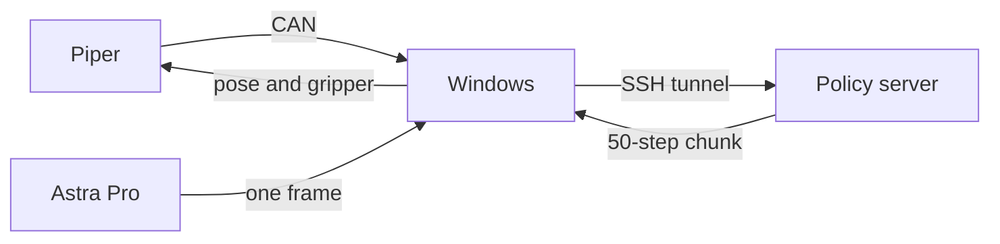

# CEI robot arms

Windows computer reads an AgileX Piper and one Orbbec Astra Pro color camera, sends the observation to a policy server over an SSH tunnel, and executes each returned end-effector chunk until you press `Ctrl+C`. Server account, host, and checkpoint live in `team_config.json`. This repository does not hard-code them.

本机是一台 Windows 电脑。它经 candleLight 读取 AgileX Piper，用 Orbbec Astra Pro 拍一张彩色图，把同一帧填进三个图像字段，经 SSH 隧道发给计算节点上的策略服务。服务每次返回 50 步末端增量。本机按底座坐标执行整段，然后重新观测，直到按 `Ctrl+C`。

操作步骤看 [`用户文档.md`](用户文档.md)，英文版是 [`USER_GUIDE.md`](USER_GUIDE.md)。改观测、动作映射或 CAN 协议时看 [`开发文档.md`](开发文档.md)，英文版是 [`DEVELOPER_GUIDE.md`](DEVELOPER_GUIDE.md)。训练数据采集的规定看 [`数据采集.md`](数据采集.md)。



## Start

Fill `team_config.json`, then run these commands in this folder:

```powershell
python team_config.py show
python team_config.py run
```

`run` submits or reuses the `serve-policy` job, opens the local forward, and starts the control loop. The arm moves. Press `Ctrl+C` and wait for `stopped`. While the server and the forward window are still up:

```powershell
python team_config.py once
```

Stop the job and the forward with `python team_config.py down`. Check the arm without moving it with `python team_config.py arm`. Save one camera frame with `python _realsense_test.py`; the picture is `_camera_test\astra_color.png`.

Close ArmRobot before any of these commands. Leave drag-teach before `run` or `once`. While status stays `TEACHING` with `teach=1`, pose commands are ignored. Edit the `prompt` string in `policy_link.py` before a run. Do not run `python piper_client.py`; that command opens and closes the gripper.

Python packages used here are `numpy`, `opencv-python`, `msgpack`, and `websockets`. The CAN client uses the Windows WinUSB API and does not import `piper_sdk`.

## Files

| File | Role |
| --- | --- |
| `team_config.json` | Login account, SSH host, checkpoint, and Slurm settings. Edit this when the environment changes |
| `team_config.py` | `run`, `once`, `down`, and `arm` |
| `policy_link.py` | Observation, WebSocket loop, and Astra Pro capture (`VID_2BC5` `PID_0501`) |
| `policy_step.py` | Turns one 12-d chunk into base-frame pose commands |
| `piper_client.py` | candleLight WinUSB client |
| `check_candidate_repo.py` | Search a candidate policy repo before changing the action mapping |
| `_can_listen.py` | Receive-only CAN capture |
| `_realsense_test.py` | Save one Astra Pro color frame |
| `episode_recorder.py` | Read-only drag-teach episode: arm feedback, one Astra frame, start and success or failure |
| `episode_check.py` | Print the episode timeline and save pose curves beside frames |
| `dataset_export.py` | Resample a successful drag episode to 0.05 s. Intervals that are not teach mode, lack a fresh image, or jump are masked out of training |

The current 12-d mapping is for one end-effector delta policy: translation, rotation, and gripper in the arm base frame. Base, torso, and mode values are dropped. A different checkpoint needs a new `action_waypoints()`.
