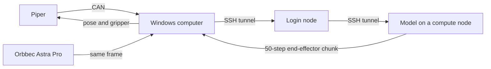

# User guide: send Piper state to a policy server

This guide is for people operating the arm. To change code, observation fields, or the CAN protocol, read `DEVELOPER_GUIDE.md`. The Chinese version is `用户文档.md`.

What this does: the Windows computer reads the arm, captures one Orbbec Astra Pro color frame, copies that same frame into the three image fields, and sends the observation through the local SSH tunnel. Each reply is a 50-step end-effector chunk. The computer plays the whole chunk in the arm base frame, then reads a new state and image and requests the next chunk, until you press `Ctrl+C`. Account, code directory, server name, and model name belong in `team_config.json`. This guide does not hard-code them.



## Find a task

| You want to | Go to |
| --- | --- |
| Run the whole link for the first time | [Run once](#run-once) |
| Check that the arm is online without moving it | `arm` in [Run once](#run-once) |
| Decide whether a run succeeded | [What success looks like](#what-success-looks-like) |
| Read the printed numbers | [What the output means](#what-the-output-means) |
| Look up an error | [When something fails](#when-something-fails) |
| Pause this run, or stop the server | [Stop this test](#stop-this-test) |
| Power off the arm after use | [After you finish](#after-you-finish) |

## Before you start

- Close ArmRobot. While it is open, this computer cannot open the CAN adapter.
- Power the arm and plug the CAN cable into the arm's CAN port.
- Run every Windows command in this folder. This folder is wherever you unpacked the code, not someone else's desktop path.
- Put the server account, checkpoint, and SSH alias in `team_config.json` in this same folder. When the machine or account changes, edit that file and generate the commands with `python team_config.py`.
- `ssh_host` may stay empty. The program then connects with `login_host` and `remote_user`. If you already have a Host in `.ssh\config`, put that Host name in `ssh_host`.

## On a Mac

Run the one-time setup in the developer guide (`brew install libusb` and the `.venv`), then use `.venv/bin/python` in place of `python` below. Before the first run:

1. Allow camera access for Terminal (System Settings > Privacy & Security > Camera). The Astra Pro is found automatically; `.venv/bin/python policy_link.py preview` shows what it sees live, and q closes the window. Only if it picks the wrong camera, put the right number from `policy_link.py cameras` in `camera_index`.
2. With `server_mode` set to `"simple"`, `.venv/bin/python team_config.py setup-remote` copies the test server to athena once. Fill `slurm_partition` first.
3. Leave room around the arm. The test server moves the end effector 10 mm along +X and back each chunk and opens or closes the gripper. A chunk farther than `max_chunk_shift_mm` from its start is refused before anything is sent.

The local forward runs in the background instead of a `piper-link` window. `down` closes it.

For joint-space chunks (the demo server), two flags tune smoothness and can be compared run to run; `team_config.py once` and `run` accept them too:

```bash
.venv/bin/python policy_link.py once --port 8000 --freq 100 --speed 60
```

`--freq` is how many times per second the joint target changes (default 100; 20 is the old stepwise behavior). `--speed` is the joint speed percent (default `joint_speed` in `team_config.json`). Each chunk prints the values it used.

## Do not

- Do not run `python piper_client.py`. That command opens the gripper fully and then closes it.
- Do not run `run` or `once` while drag-teach is still on. While status stays `TEACHING` with `teach=1`, end-effector commands are ignored. Leave teach mode first so status can enter `CAN_CTRL`.
- Leave room around the arm. Each chunk is all 50 steps returned by the model, and the travel can be more than 1 cm.
- The language instruction is the `prompt` field in `policy_link.py`. Change that English sentence before a run. There is no separate command-line prompt.
- Do not install a fresh environment on the compute node. Use the Python already installed under `openpi_dir`.
- Do not copy a job script or an SSH forward from this guide onto the login node. `run`, `once`, and `down` connect by themselves.

## Run once

Edit `team_config.json`. Fill in the login address, account, code directory, config name, checkpoint directory, port, and also `log_dir`, `slurm_partition`, `slurm_time`, and `slurm_mem`. See what is still empty:

```powershell
python team_config.py show
```

Then, in this folder, run:

```powershell
python team_config.py run
```

`run` does the rest:

1. Connect to the login node. When it asks for a password, type it in this window. The characters are not shown.
2. Submit a job named `serve-policy` when you do not already have one, and reuse it when you do. `--port` is placed before `policy:checkpoint`.
3. Check the job about every 10 seconds. After the log says the server is listening, read the compute-node address. Warnings from a simulator while the model loads can be ignored for now. Do not SSH into the compute node; SSH can hang while the node is busy.
4. Open a window titled `piper-link` for the local forward. Type the SSH password once more in that window, then leave it open.
5. Read the arm and the Astra Pro, send an observation, execute the whole returned chunk, then start the next chunk. The port is `local_forward_port`. The arm moves. Press `Ctrl+C` to stop the loop.

While the server and the forward window are still up, start another continuous run without submitting again:

```powershell
python team_config.py once
```

To check that the arm is online without contacting the server:

```powershell
python team_config.py arm
```

Success: the output contains `complete=True`, six joint angles, a gripper opening in millimeters, and an end-effector pose. The arm does not move.

## What success looks like

These lines appear first:

```text
server_connected
observation_sent
waiting_for_inference
```

After `waiting_for_inference`, the first model compilation can take several minutes. The run should then show `cycle=1`, `image_mean`, `complete=True`, `actions_shape=(50, 12)`, `command_steps=50`, and `pose_sent`. `image_mean` should be well above 0. After a chunk, `after` prints the new pose and `cycle=2` starts.

A chunk that reached its target shows `CAN_CTRL` and `motion=0`. The pose under `after` should be close to the `target_mm_deg` printed for that chunk. If the server reports a missing observation field, `build_observation()` does not yet match that model. See the developer guide.

## What the output means

| Printed text | Meaning |
| --- | --- |
| `joints_deg` | Current angle of the six joints, in degrees |
| `gripper_mm` | Gripper opening, in millimeters |
| `pose_mm_deg` | End-effector position in millimeters and orientation in degrees |
| `complete=True` | Joints, gripper, pose, and status were all received |
| `image_mean` | Average brightness of the Orbbec Astra Pro color frame after padding to 224×224. Only one camera is connected, so that same frame fills the external, wrist, and right image fields |
| `cycle` | Which chunk this is. Each chunk captures a new frame and requests a new inference |
| `command_steps` | How many steps of this chunk were sent. The current code sends every step the model returned |
| `shift_mm` | Total end-effector translation of this chunk, in millimeters |
| `target_mm_deg` | Target pose of the last step in this chunk |
| `pose_sent` | The pose commands for this chunk have been written |
| `after` | Joints, gripper, and pose read back after the chunk |

The current mapping reads the model output in the arm base frame: the first three values are end-effector translation, the next three are rotation about the base axes, and the next value is the gripper. Base, torso, and mode values have no mechanism on this arm and are not sent. Re-check that meaning in the developer guide after changing models. The language instruction is not typed on the server.

## Stop this test

`run` and `once` keep looping. Press `Ctrl+C` in that window. After `stopped` appears, the prompt returns. The policy server and the `piper-link` forward window stay up, and the compute node keeps the GPU.

To stop the server and release the GPU:

```powershell
python team_config.py down
```

This cancels `serve-policy` jobs under your account and closes the local forward. Type the SSH password in this window when asked.

A server you started by hand on the GPU machine is not a job. Press `Ctrl+C` in that server window, then run `down` to close the local forward.

After the software has stopped, power off the arm as described in the next section.

## After you finish

Confirm that `python team_config.py down` has finished, then follow this order:

1. Press the button on the arm once, and wait until the green light stays on.
2. Drag the arm back to the zero pose by hand. The zero pose is on page 6 of the user manual.
3. Press the button again, and wait until the green light turns off.
4. Unplug the power after the green light is off.

## When something fails

| What you see | What it means | What to do |
| --- | --- | --- |
| Fill these keys in team_config.json | Some config fields are still empty | Fill the listed keys, then run `python team_config.py show` |
| A direct connection from Windows to the server port times out | The login node often does not expose the policy port | Run `python team_config.py run`. It forwards to the compute-node address |
| The `piper-link` window sits there with no prompt | The forward is up | Leave that window open and return to the first one |
| Enter after the password only moves to the next line | The forward window does not open a shell | Press Enter once for the password |
| `channel ... Connection timed out` | The forward is aimed at a compute node that is no longer listening | Run `python team_config.py down`, then `python team_config.py up` |
| The log says `--port` is unrecognized | An older launch script was used | Run `python team_config.py run` again |
| The log fails while compiling `av` | The wrong Python is being used | The launch command uses `.venv/bin/python`, not `uv run` |
| The server reports a missing `observation` field | The observation does not match this model | Change `build_observation()` as described in the developer guide, and do not execute the actions |
| `timed out in 5.0s` | An older client did not wait long enough for the model | Use the current program; it prints `waiting_for_inference` first |
| The log shows the job already exited | The server is not still on the compute node | Read the log tail printed by `run`, fix the config, and run `run` again |
| CAN cannot be opened, error 5 | ArmRobot, VMware, or a Python process from an earlier run owns the adapter | Close ArmRobot. If it still fails, unplug and replug the candleLight, then see device ownership in the developer guide |
| Status stays `TEACHING` and the pose does not change | Drag-teach is on, so pose commands are ignored | Leave teach mode, then run `once` |
| Exit code `3221225477` | An access violation occurred when the camera and CAN writes shared one process | Use the current program. Motion is sent from a separate process |
