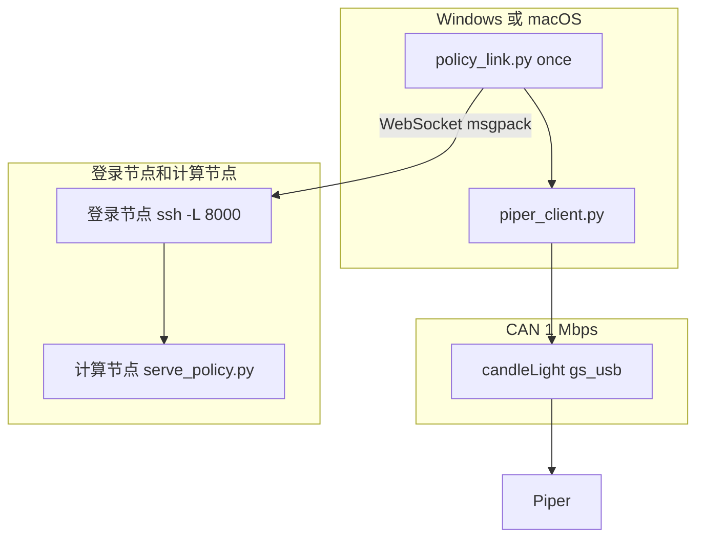

# 开发文档：Piper 客户端与策略链路

这份文档给要改代码或查协议的人。操作步骤在 `用户文档.md`。英文版是 `DEVELOPER_GUIDE.md`。



## 从这里找

| 要改或要查的内容 | 位置 |
| --- | --- |
| 只读状态、夹爪动作 | [piper_client.py](#piper_clientpy) |
| 发给模型的字段 | [观测契约](#观测契约) |
| 模型返回后怎么变成末端指令 | [动作契约](#动作契约) |
| WebSocket 和超时 | [策略链路](#策略链路) |
| 设备打不开 | [设备占用](#设备占用) |
| CAN 帧格式和 ID | [协议](#协议) |
| 已经证明走不通的库 | [不要换的入口](#不要换的入口) |
| 还没做的功能 | [边界](#边界) |
| 拿到一个候选策略仓库 | [候选仓库核对](#候选仓库核对) |

## 仓库里用哪几个文件

| 文件 | 职责 |
| --- | --- |
| `piper_client.py` | 打开 candleLight（Windows 用 WinUSB，macOS 用 libusb），读 `0x2A1`–`0x2A8`，发夹爪 `0x159`、退出示教 `0x150`、使能 `0x471`、MOVE P `0x151` 和末端位姿 `0x152`–`0x154` |
| `policy_link.py` | 组观测、保持一条 WebSocket，循环推理。相机和 CAN 写不放在同一个进程 |
| `policy_step.py` | 把一段动作积成底座坐标下的末端轨迹并写到 CAN。运行时不导入 `piper_sdk` |
| `team_config.json` | 登录账号、SSH 别名、checkpoint 和日志目录。换环境时只改这里 |
| `team_config.py` | `run` 提交作业、等待监听、打开一条本机转发并开始连续控制。`once` 在转发已开时再开始一轮。`down` 取消作业并关掉转发。`job` 和 `serve` 仍只打印命令 |
| `simple_policy_server.py` | 不带模型、测试链路用的脚本化策略服务器。见 [macOS 与简单服务器](#macos-与简单服务器) |
| `用户文档.md` | 操作步骤 |
| `_can_listen.py` | 只接收、不发送的抓包。日志写在本目录的 `_can_listen_log.txt` |
| `check_candidate_repo.py` | 拿到候选策略仓库后先检索配置、动作、归一化、相机和 Piper 执行代码 |
| `prepare_dataset.py` | 把成功的示教整理成 `datasets/piper_finetune`。服务器改动见 `服务器训练对接.md` |

路径都相对于这份代码所在的目录。不要在文档或新代码里写某个人的桌面绝对路径。服务器路径以 `team_config.json` 为准。

`piper_sdk` 和 `piper_ros` 在仓库里，但都走 Linux `can0`。Windows 和 macOS 上的控制循环都不调用它们。协议里的 CAN 编号和字节顺序对照过 SDK，发送仍由 `piper_client.py` 完成。

直接运行 `python piper_client.py` 会查询夹爪上限，再执行一次最大开合。库函数 `read_state()` 不发送运动指令。

## piper_client.py

`PiperClient` 是上下文管理器。Windows 上连接时用重叠 I/O 打开 WinUSB，macOS 上用 libusb。两边都把适配器设成 48 MHz 时钟下的 1 Mbps，然后启动控制器。

`read_state(timeout=0.6)` 收齐下面 8 个 ID 才把 `complete` 设为 True：

| 字段 | 来源 | 单位 |
| --- | --- | --- |
| `joints_deg` | `0x2A5`–`0x2A7`，6 个数 | 度 |
| `gripper_mm` | `0x2A8` 前 4 字节 | 毫米 |
| `gripper_effort` | `0x2A8` 后随的 uint16 | 0.001 N·m |
| `gripper_status` | `0x2A8` 的状态字节 | 原始值 |
| `pose_mm_deg` | `0x2A2`–`0x2A4` 的 `x y z rx ry rz` | 毫米和度 |
| `status` | `0x2A1` | 见协议一节 |

多字节整数是大端，原始值除以 1000。

`gripper_max_mm()` 发送查询 `0x477`，数据 `04 00 00 00 03 00 00 00`。`0x47E` 的 byte 1 为 70 或 100 时采用该值，否则回退到 70。本机曾经返回 100。这个查询不修改负载。

`move_gripper(target_mm, effort=1000)` 只发 `0x159`。目标限制在 0–100 mm，力矩限制在 0–5000。约每 10 ms 重发，直到反馈与目标相差不超过 1 mm，或超过 4 秒。它不调用关节使能。byte 7 固定为 0，避免把当前位置写成零点。

已验证过一次夹爪全行程开合，开合前后关节角不变。具体角度以现场 `read_state()` 为准，不要写进给别人用的配置。

`exit_drag_teach()` 发送 `0x150`，数据 `00 00 02 00 00 00 00 00`，结束拖动示教记录。它不急停，也不写零点。`enable_arm()` 发送 `0x471`，数据 `07 02` 加 6 个 0，使能全部关节。`set_pose_mode(speed)` 发送 `0x151`：CAN 控制、MOVE P、给定速度百分比，安装位置字节保持 0。`move_pose(...)` 按大端发送 `0x152`（X、Y）、`0x153`（Z、RX）、`0x154`（RY、RZ），单位 0.001 mm 和 0.001 度，并在同一段时间里重发模式帧。可选地同时重发一条夹爪帧。

`0x2A1` 的控制模式为 `0x02`（`TEACHING`）且示教字节为 `0x01` 时，末端位姿指令不被跟随。退出示教后，一次已验证的运动以 `CAN_CTRL` 和 `motion=0` 结束，读回位姿接近发出的目标。低速反馈 `0x261`–`0x266` 的第 6 字节 bit 6 为 1 时，该关节驱动已使能。

读写使用各自的事件。写完一帧要等完成，并读走发送回显，否则后续写会停住。关闭时取消未完成的 I/O 后释放接口，不再做会卡住的总线停止控制传输。相机和 CAN 写放在同一个进程里会以访问冲突退出（`3221225477`），所以 `policy_link.py` 把动作数组交给一个新的 `policy_step.py` 进程。

## 策略链路

`policy_link.py` 使用和 `openpi_client` 相同的 WebSocket：连接后服务器先发一条 msgpack 元数据，之后每次观测一条 msgpack，回复也是一条 msgpack。NumPy 用 `__ndarray__` 字段传输，键为 bytes：`data`、`dtype`、`shape`。

服务器目录、账号、主机名和模型名只放在每个人自己的 `team_config.json`。缺字段时 `team_config.py` 会列出要填的键，不会套用别人的路径。操作员执行 `python team_config.py run`：它在登录节点提交或复用名为 `serve-policy` 的作业，等日志出现 `listening on`，用 `scontrol` 的 `NodeAddr` 从本机做一条 `ssh -L`，然后调用 `policy_link.py once`。Windows 上转发窗口留着；macOS 上转发在后台，`down` 用 `pkill` 关掉。`down` 取消该用户名下的 `serve-policy` 作业并结束本机对应的 `ssh -N`。`job` 和 `serve` 仍只打印文本，给需要手工启动的人。

`once` 的顺序：

1. 最多重试 50 次连接 `ws://host:port`，单次握手超时 2 秒。`python team_config.py once` 和未写 `--port` 的 `python policy_link.py once` 都使用 `local_forward_port`。`python policy_link.py serve` 仍默认监听 `127.0.0.1:8765`，那是本机占位服务。
2. 30 秒内接收元数据，打印 `server_connected`。
3. `read_state()`。不完整就抛错，不发送。
4. `capture_color()` 从 Orbbec Astra Pro 的彩色相机（USB `VID_2BC5` `PID_0501`）取一张 RGB 图，填充到 224×224。同一台电脑上的其他摄像头不会被选中。`build_observation(state, image)` 把同一帧复制到三个图像字段。
5. 发送观测，打印 `image_mean` 和 `waiting_for_inference`。
6. 最多等 600 秒。回复若是字符串，原样作为 `RuntimeError` 抛出，这是 OpenPI 返回异常的方式。
7. 打印 `actions_shape`。一次已验证的返回是 `(50, 12)`。然后在单独进程里执行整段，打印 `pose_sent` 和执行后的状态。
8. 回到第 3 步。`Ctrl+C` 打印 `stopped` 并退出。WebSocket 在整个循环里保持连接。读状态用的 CAN 客户端在发送动作前关闭，避免和写进程同时占用适配器。

`python policy_link.py serve` 是本机占位服务，监听 `127.0.0.1:8765`。它只检查当前代码里的观测形状并返回占位动作，不能代替任何人的 checkpoint。

## 观测契约

图像张数、状态维度、提示词和动作含义都由所加载的模型决定，不是仓库里的固定标准。换模型时改 `build_observation()`，并让 `team_config.json` 的 `policy_config` 与 `checkpoint_dir` 指向那一份权重。

当前函数里的填法只是代码现在的样子，下表不是所有人的输入：

| 键 | 值 |
| --- | --- |
| `observation/image` | uint8，`(224, 224, 3)`，Orbbec Astra Pro 彩色帧 |
| `observation/wrist_image` | 同一帧的副本。目前没有第二台相机 |
| `observation/right_image` | 同一帧的副本。有的模型不需要第三张图，缺键时以服务器返回的错误为准 |
| `observation/state` | float32，形状 `(16,)` |
| `prompt` | 当前源码里的字符串。运行前按任务修改。语言指令不在服务器上输入 |

当前这 16 个数的顺序是函数 `robocasa_state()` 里写死的。另一份模型若使用别的顺序或别的长度，应替换这个函数，而不是沿用下表：

| 下标 | 内容 | 本客户端怎么填 |
| --- | --- | --- |
| 0–2 | 末端相对位置，米 | Piper 末端 `x y z` 毫米除以 1000。这是绝对位姿，不是训练时的相对量 |
| 3–6 | 末端四元数 wxyz | 由 `rx ry rz` 度按内禀 XYZ 转成四元数 |
| 7–9 | 底盘位置，米 | 0。Piper 没有移动底盘 |
| 10–13 | 底盘四元数 wxyz | `1 0 0 0` |
| 14–15 | 两指关节位置，米 | 开口毫米数除以 2000，两指填同一个数 |

不要改 msgpack 封装。只有一台 Astra Pro 时，三个字段必须说明是同一帧。这 16 维的顺序还没有和训练数据的状态拼接逐项核对；换模型前先跑候选仓库核对。当前控制不使用相机外参，没有做手眼标定。

## 动作契约

`policy_step.py` 的 `action_waypoints()` 按下面的规则解释当前这段 12 维输出。这是已经对照过的一份末端增量策略，不是所有 checkpoint 的通用格式。换模型时替换这个函数，不要把 12 个数当成六个关节角写入 `0x155`。

| 下标 | 含义 | 本客户端怎么用 |
| --- | --- | --- |
| 0–2 | 末端平移，底座坐标，控制器单位约在 [-1, 1] | 乘 0.05 m，再乘 1000 得到毫米，加到当前 `x y z`。+X 向前，+Y 向左，+Z 向上 |
| 3–5 | 轴角，同一底座坐标，控制器单位约在 [-1, 1] | 乘 0.5 rad，左乘到当前姿态。欧拉角与 `piper_fk` 一致：`R = Rz(rz) Ry(ry) Rx(rx)` |
| 6 | 夹爪 | 大于等于 0.5 视为闭合，目标 0 mm；否则张开到 `gripper_max_mm()` |
| 7–10 | 底盘与升降 | 这台 Piper 没有这些机构，丢掉 |
| 11 | 控制模式 | 不是长度，丢掉 |

`team_config.json` 的 `execute_steps` 只保留每个 chunk 的前 N 步（空着则全部执行），`ee_delta_scale` 缩放平移和旋转（空着则为 1）。发送前 `check_limits()` 拒绝离起点超过 `max_chunk_shift_mm` 的 chunk，一帧都不发。保留下来的每一步按 0.05 秒、速度 50% 发送。一段走完后，`policy_link.py` 用新的图像和状态再要一段。已验证：退出示教后，一段的终点位姿能被手臂跟上，`motion=0`。

## macOS 与简单服务器

Windows 和 macOS 都支持。`piper_client.py` 按平台选传输层：Windows 用 `_WinUsbTransport`，macOS 用 `_LibUsbTransport`（pyusb，VID `1D50` / PID `606F`）。`open_transport()` 对两者发送同样的 gs_usb 控制传输，20 字节帧、发送回显的排空和所有 CAN ID 都共用。`_can_listen.py` 在 macOS 上也走 libusb。

libusb 传输层用后台线程持续读 IN 端点，放进 256 帧的队列（约 0.1 s 反馈，满了丢最旧的）。不这样做的话，约 2700 帧/s 的反馈会耗尽适配器的帧缓冲，十几帧之后 OUT 写入就以 errno 60 超时。不要改回只在写入之间读。

Mac 上的准备：

```bash
brew install libusb
python3 -m venv .venv
.venv/bin/pip install numpy msgpack 'websockets>=13' opencv-python pyusb pyobjc-framework-AVFoundation pandas pyarrow
```

macOS 上 OpenCV 按 `uniqueID` 排序给相机编号，不能按 USB ID 选。`_avfoundation_devices()` 用 pyobjc 复现这个顺序，model ID 含 `VendorID_11205 ProductID_1281`（0x2BC5 / 0x0501）的就是 Astra Pro。`team_config.json` 的 `camera_index` 不为空时以它为准。`python policy_link.py cameras` 列出编号和名字。`python policy_link.py preview [--index N]` 打开实时窗口，左上角是 224×224 的模型输入，按 q 关闭。运行命令的 App 需要相机权限。

`policy_step.check_limits()` 在发送任何帧之前运行。只要某个 waypoint 离本 chunk 开始前读到的位姿超过 `max_chunk_shift_mm`（默认 30），或者落在基座系绝对盒子 `workspace_mm`（`{"x": [min, max], ...}`，空的轴跳过）之外，就 raise，一帧都不发。

`simple_policy_server.py` 按 `action_waypoints()` 的动作含义返回脚本化的 `(50, 12)` chunk：沿 +X 走 10 mm 再回来，夹爪每个 chunk 交替开合。`server_mode` 为 `"simple"` 时，`team_config.py setup-remote` 把它和 `policy_link.py`、`piper_client.py` 拷到 `remote_code_dir` 并在那里建 venv；`run` 随后不申请 GPU 提交它。`"openpi"` 仍走 `serve_policy.py`。非 Windows 上本地转发是后台的 `ssh -f -N -L`，`down` 用 `pkill` 关掉。

## 关节空间动作

从折叠的休息位姿发末端位姿（MOVE P）目标，会被机械臂自己的逆解拒绝：状态显示 `TARGET_EXCEEDS_LIMIT`，只有夹爪会动。所以回复里可以带 `"action_space": "joints"`，动作为 `(N, 7)`：六个绝对关节角（度）加一个夹爪值（≥0.5 合上）。`policy_link.py` 把动作空间传给 `policy_step.py apply`；回复里没有这个字段时按 `ee_delta` 处理。

`apply_joint_actions()` 发 MOVE J（`0x151` 第 1 字节 = `0x01`），关节角走 `0x155`（J1、J2）、`0x156`（J3、J4）、`0x157`（J5、J6），大端 int32，单位 0.001 度，每步 0.05 s，速度为 `joint_speed`（默认 60%）。每一步内部 `move_joints(start_deg=...)` 从上一个目标插值，约每 5–7 ms 重发一次（约 140 Hz）。MOVE J 对每个新目标都重新规划，所以每 0.05 s 只换一次目标时，J1、J2 每一步都会起停、一卡一卡；速度 30% 时机械臂还跟不上指令的速度。发送前 `check_joint_chunk()` 会拒绝任一步让某个关节变化超过 3 度的 chunk，也拒绝离起点超过 `max_chunk_joint_deg`（默认 100）的 chunk。`move_joints()` 拒绝超出 `JOINT_LIMITS_DEG` 2 度以上的目标，小于 2 度的截到限位。observation 里带有 `observation/joints_deg`，供脚本化服务器使用。

`simple_policy_server.py --mode demo`（默认）先以半速展开到 `READY_DEG = [0, 45, -45, 0, 30, 0]`，然后轮流做：J1 挥手（±30）、J5 点头加 J2/J3 前伸、J6 ±90 转腕并开合夹爪。每段的步数按距离调整，保证任一关节每步不超过 2.4 度。`--mode nudge` 保留原来的末端位移测试。

低速反馈 `0x261`–`0x266` 里，驱动使能标志是第 5 字节（从 0 数）的 bit 6。

## 回放与服务器模式

回放用 `episode_recorder.py` 录的拖动示教（见 `数据采集.md`）。`episode_arrays()` 从 `robot_feedback.parquet` 读 `j1_deg`–`j6_deg`、`gripper_mm`、`t_robot`，也能从 `.npz` 读同样的数组。`setup-remote` 用 `write_replay_npz()` 写出这个 `.npz`，上传为 `episodes/<episode 文件夹名>.npz`，服务器的 venv 不需要 pandas。录制脚本在 Windows 和 macOS 上都能跑：`open_policy_camera()` 用 DirectShow 或 AVFoundation 找 Astra Pro，`KeyReader` 通过 `msvcrt` 或 cbreak 模式的终端读 `s`/`f`/`d`（退出时恢复；macOS 之后会置上 `PENDIN`，无害）。

`simple_policy_server.py --mode replay --episode FILE` 用 `np.interp` 重采样到 0.05 s 一步，夹爪小于等于 `dataset_export.GRIPPER_CLOSE_MM`（28 mm）记为合上，超过 2.4 度的步会被拆开。每次回复下一段 `--chunk` 步（默认 50）。机械臂离这段第一行超过 2.4 度时（第一个 chunk、循环重来或跟踪滞后），前面加一段半速的 `keyframe_chunk()` 过渡。播完回复 `{"actions": (0, 7), "done": True}`，`policy_link.py` 打印 `server_done` 后返回；加 `--loop` 则从头再来。每个连接都从头回放。

`team_config.py` 的 `--server simple|replay|openpi` 覆盖 `server_mode`，再套用 `mode_overrides[mode]`（任意键，通常是 Slurm 的分区、内存、时长）。`replay` 模式下 `setup-remote` 会把 `replay_episode` 拷到 `remote_code_dir/episodes/`。`openpi` 在 GPU 上运行 `openpi_python`（默认是 `openpi_dir` 里的 `.venv/bin/python`）；`openpi_dir`、`openpi_python`、`checkpoint_dir` 都可以用 `~/` 开头。任务带 `--comment=MODE`；`up` 不会复用另一种模式起的 `serve-policy` 任务。任务地址和 `piper_link_state.json` 里存的不一样时，`up` 会关掉旧的本地转发再开新的。

`apply_actions()` 只保留前 `execute_steps` 行（空则全部），并把 `ee_delta_scale`（空则 1.0）传给 `action_waypoints()`，平移和旋转都乘上它。限位检查抛 `ChunkRefused`；`policy_step.py apply` 随后以状态码 3 退出，`policy_link.py` 打印 `chunk_refused` 并重新观测，不再停掉循环。RoboCasa pi0.5 checkpoint 第一次调用约 30 s，之后每次约 0.15 s；不缩放时一个 chunk 积分出来是 0.3–1.5 m。

`policy_link.py home` 走同一个 `go_to()`，收回到 `HOME_DEG`（全 0，即休息位）。`policy_link.py ready` 和 `once --ready` 在跑 `ee_delta` 模型之前用关节目标展开到 `READY_DEG`，因为从折叠姿态发末端位姿目标会被拒绝。


适配器是 candleLight，`VID_1D50` / `PID_606F`，CAN 时钟 48 MHz。Windows 上它是 WinUSB，接口 GUID `{c15b4308-04d3-11e6-b3ea-6057189e6443}`。macOS 上用 libusb 打开同一个 VID/PID。

会让 `CreateFile` 返回错误 5 的来源：

1. ArmRobotUA。它用 `cando.dll` 独占设备，没有外部 SDK 或 ROS 端口。关掉程序后，非管理员进程可以打开同一接口。
2. `VMUSBArbService`。排查时曾把它停掉。虚拟机需要 USB 时再手动启动。
3. 上一次卡在驱动里的 Python 进程。关掉那个进程，仍失败时拔插 candleLight。

打开参数必须包含 `FILE_FLAG_OVERLAPPED`（`0x40000000`）。否则 `WinUsb_Initialize` 返回错误 6。读写使用 `OVERLAPPED`，997 表示 I/O 尚未完成。本机批量管道是 IN `0x81`、OUT `0x02`，换适配器时用 `WinUsb_QueryPipe` 再确认。

## 协议

发给适配器的 USB 控制传输和发给 Piper 的 CAN 帧不是一类数据。

控制传输：主机字节序请求 0，载荷 `0x0000BEEF`；位定时请求 1；启动请求 2 且 mode 为 1。48 MHz、1 Mbps 的定时是 `prop_seg=1, phase_seg1=12, phase_seg2=2, sjw=1, brp=3`。80 MHz 才用 `brp=5`。

gs_usb 帧 20 字节，无硬件时间戳：

```text
0   echo_id  uint32 小端
4   can_id   uint32 小端
8   dlc
12  data     最多 8 字节
```

`echo_id == 0xFFFFFFFF` 才是总线上收到的帧。`echo_id == 0` 是本机发送回显，不是臂的回复。标准 ID 取 `can_id & 0x7FF`。错误帧标志是 `0x20000000`，客户端会丢掉。

正常播报时大约：

| ID | 频率 | 内容 |
| --- | --- | --- |
| `0x2A1` | 约 190 Hz | 控制模式、臂状态、运动模式、示教、运动状态、轨迹号、故障码 uint16 大端 |
| `0x2A2`–`0x2A4` | 约 190 Hz | 末端 XYZ、姿态 |
| `0x2A5`–`0x2A7` | 约 190 Hz | 六个关节 |
| `0x2A8` | 约 190 Hz | 夹爪行程、力矩、状态 |
| `0x251`–`0x256` | 约 95 Hz | 驱动器高速反馈 |
| `0x261`–`0x266` | 约 19 Hz | 驱动器低速反馈 |

本机一次 `0x2A1` 原始字节是 `01 00 01 02 00 00 00 00`：CAN 控制、正常、MOVE_J、示教状态 2、运动状态 0、故障码 0。枚举在 `piper_sdk/.../arm_feedback_status.py`。

`0x710` 在早期短监听里出现过，25 秒被动监听里没有。没有可靠含义，不要回复。`0x1C0`–`0x1C3` 和 `0x212` 也出现过，客户端不解释它们。

固件查询是 `0x4AF`，数据 `01 00 00 00 00 00 00 00`。把接收载荷拼起来找 ASCII `S-V`。版本以现场读到的字符串为准。有这份回复只说明控制器在总线上，不等于周期反馈已经在发。

夹爪指令 `0x159` 的 8 字节为大端：int32 行程（0.001 mm）、uint16 力矩（0.001 N·m）、uint8 使能码、uint8 设零。设零字节必须是 `0x00`。`0xAE` 会把当前位置写成零点，禁止发送。使能码使用 `0x01`。不要为了周期反馈去猜 `0x477` 的第 3 字节，SDK 里两处说明互相矛盾。

## 不要换的入口

| 入口 | 结果 |
| --- | --- |
| `C_PiperInterface_V2("can0")` | 只适用于 Linux socketcan |
| `python-can` 的 `gs_usb` / libusb | 对本机 WinUSB 设备权限不足 |
| `pyAgxArm` + `agx_cando` | 官方 Windows 路线，这台机器没装也没验证 |
| `piper_ros` | Linux `can0` |
| ArmRobot 的界面或它内部的 `QTcpSocket` | 不监听外部端口，并独占适配器 |

## 候选仓库核对

拿到候选仓库后，先运行核对，再讨论怎么映射到 Piper。把仓库路径换成实际目录：

```powershell
python check_candidate_repo.py 仓库路径
```

程序会按下面五项检索线索，并给出文件和行号。它不能代替阅读。每一项都要写成确定结论后，才允许改 `build_observation()` 或发送关节指令。

1. 配置：单臂还是双臂，输入状态和输出动作各多少维。
2. 动作：关节角还是末端位姿，绝对值还是增量，单位是什么。
3. 预处理与后处理：是否包含训练时使用的归一化统计量或处理器文件。
4. 相机：需要哪些视角、字段名、分辨率。
5. 部署代码：是否有对应 Piper 驱动、夹爪映射和执行频率的实现。

这五项里只要动作类型、单位或相机字段仍不确定，就不要把检索到的数组直接写入 `0x155` 或 `0x159`。先改 `action_waypoints()`。

## 边界

已经在一套 Piper 和 candleLight 上验证的是：被动收齐 `0x2A1`–`0x2A8`，夹爪全行程开合且关节不变，WebSocket 能把观测送到策略服务并拿回 `(50, 12)`，退出示教后一段末端轨迹能被跟随。

已经接上一台 Orbbec Astra Pro 彩色相机。彩色帧进入观测，并复制到三个图像字段。连续控制是外层循环：整段执行完，再观测，再推理。还没有做的是：独立的腕部和右侧相机、手眼标定、16 维状态顺序与训练拼接的逐项核对、关节空间 `0x155` 指令、主从偏移。当前这条链路不消费相机外参。换一份动作含义不同的模型时，先改 `action_waypoints()`。
