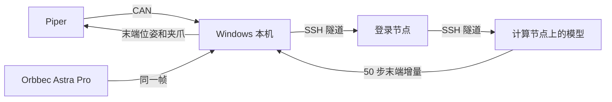

# 用户文档：把 Piper 的状态发给策略服务

这份文档给要操作的人。改代码、改观测字段或查 CAN 协议时看 `开发文档.md`。英文版是 `USER_GUIDE.md`。

当前能做的事：这台 Windows 电脑读出机械臂状态，用一台 Orbbec Astra Pro 拍一张彩色图，把同一帧填进三个图像字段，经本机 SSH 隧道发给策略服务。服务每次返回一段 50 步的末端增量。本机按底座坐标把整段发出去，然后重新读取状态和图像，再要下一段，直到按 `Ctrl+C`。账号、代码目录、服务器名和模型名都写在 `team_config.json`，文档里不写死。



## 从这里找

| 你要做的事 | 去哪一节 |
| --- | --- |
| 第一次把整条链路跑起来 | [跑一次](#跑一次) |
| 确认机械臂在线，但不要让它动 | [跑一次](#跑一次) 里的 `arm` |
| 看某次输出算不算成功 | [怎样算通过](#怎样算通过) |
| 屏幕上的数字是什么意思 | [打印出来的内容](#打印出来的内容) |
| 报错了 | [出问题先看这里](#出问题先看这里) |
| 暂停这一次，或结束服务器 | [停掉这次测试](#停掉这次测试) |
| 用完后给机械臂断电 | [用完以后](#用完以后) |

## 开始前

- 关掉 ArmRobot。它开着时，本机打不开 CAN 适配器。
- 机械臂已上电，CAN 线插在臂的 CAN 口。
- 下面所有 Windows 命令都在本文件夹里执行。本文件夹是你解压或打开的这份代码所在的目录，不是某一个人的桌面路径。
- 服务器账号、checkpoint 和 SSH 别名写在同目录的 `team_config.json`。换机器或换账号时只改这个文件，然后用 `python team_config.py` 生成命令。
- `ssh_host` 可以留空。留空时程序用 `login_host` 和 `remote_user` 连接。你已经在 `.ssh\config` 里写过 Host 时，把那个 Host 名填进 `ssh_host`。

## 不要做

- 不要运行 `python piper_client.py`。那条命令会把夹爪张开再合上。
- 不要在拖动示教还开着时执行 `run` 或 `once`。状态停在 `TEACHING` 且 `teach=1` 时，末端指令不会被跟随。先退出示教，使状态能进入 `CAN_CTRL`。
- 手臂旁边留出活动空间。每一段是模型返回的全部 50 步，位移可以超过 1 厘米。
- 语言指令写在 `policy_link.py` 的 `prompt` 字段里，运行前改成你要的英文句子。命令行没有单独的输入位置。
- 不要在计算节点上重新安装一份环境。使用 `openpi_dir` 里已经装好的 Python。
- 不要把作业脚本或 SSH 转发从文档抄到登录节点。`run`、`once` 和 `down` 会自己连接。

## 跑一次

先编辑 `team_config.json`，填登录地址、账号、代码目录、配置名、checkpoint 目录、端口，以及 `log_dir`、`slurm_partition`、`slurm_time`、`slurm_mem`。查看还空着的项：

```powershell
python team_config.py show
```

然后在本文件夹执行：

```powershell
python team_config.py run
```

`run` 会自己完成这些事：

1. 连接登录节点。提示密码时在当前窗口输入，屏幕上没有字符。
2. 没有名为 `serve-policy` 的作业就提交，已有就继续用。`--port` 会放在 `policy:checkpoint` 前面。
3. 大约每 10 秒看一次作业。日志里出现服务正在监听后，读取计算节点地址。加载时的仿真环境警告可以先不管。不要登录计算节点，节点忙时 SSH 会卡住。
4. 打开标题为 `piper-link` 的窗口做本机转发。在那个窗口再输入一次密码，然后留着它。
5. 读取机械臂和 Astra Pro，发送观测，执行返回的整段动作，然后立刻开始下一段。端口用 `local_forward_port`。机械臂会动。按 `Ctrl+C` 停止循环。

服务器还在、转发窗口也还开着时，再开始一轮连续控制不用重新提交：

```powershell
python team_config.py once
```

只确认机械臂在线、不连服务器：

```powershell
python team_config.py arm
```

通过时打印 `complete=True`，并有六个关节角、夹爪毫米数和末端位姿。机械臂不动。

## 怎样算通过

先出现：

```text
server_connected
observation_sent
waiting_for_inference
```

`waiting_for_inference` 之后可能还要等几分钟，这是模型第一次编译。随后应看到 `cycle=1`、`image_mean`、`complete=True`、`actions_shape=(50, 12)`、`command_steps=50` 和 `pose_sent`。`image_mean` 应明显大于 0。一段结束后打印 `after` 里的新位姿，并开始 `cycle=2`。

到位时 `status` 里有 `CAN_CTRL`，且 `motion=0`。`after` 的末端位姿应接近刚才打印的 `target_mm_deg`。若服务器返回缺少某个观测字段，说明 `build_observation()` 还没按那个模型改，看开发文档。

## 打印出来的内容

| 打印 | 含义 |
| --- | --- |
| `joints_deg` | 六个关节的当前角度，单位度 |
| `gripper_mm` | 夹爪开口，单位毫米 |
| `pose_mm_deg` | 末端位置（毫米）和姿态角（度） |
| `complete=True` | 关节、夹爪、末端和状态都读到了 |
| `image_mean` | Orbbec Astra Pro 彩色帧缩放到 224×224 后的平均亮度。只有一台相机，同一帧填入外部、腕部和右侧三个字段 |
| `cycle` | 第几段。每一段都重新拍照、重新推理 |
| `command_steps` | 这一段实际发出的步数。当前代码发出模型返回的全部步 |
| `shift_mm` | 这一段末端平移的总长度，毫米 |
| `target_mm_deg` | 这一段最后一步的目标位姿 |
| `pose_sent` | 这一段的位姿指令已经写完 |
| `after` | 执行后读回的关节、夹爪和末端 |

当前映射按底座坐标解释模型输出：前三维是末端平移，接着三维是绕底座轴的转动，再一维是夹爪。底盘、升降和模式那几维没有对应机构，不发送。换模型后这段含义要按开发文档重核。语言指令不在服务器上输入。

## 停掉这次测试

`run` 和 `once` 会一直循环。在那个窗口按 `Ctrl+C`，看到 `stopped` 后回到提示符。策略服务和 `piper-link` 转发窗口都还在，计算节点继续占着 GPU。

结束服务并释放 GPU：

```powershell
python team_config.py down
```

它会取消你账号下名为 `serve-policy` 的作业，并关掉本机转发。提示密码时在当前窗口输入。

直接在 GPU 机器上启动的服务不在作业里。回到那个服务窗口按 `Ctrl+C`，再执行上面的 `down` 关掉本机转发。

软件停掉之后，按下一节给机械臂断电。

## 用完以后

先确认 `python team_config.py down` 已经执行完，再按这个顺序：

1. 按一下机械臂上的按钮，等到绿色灯常亮。
2. 用手把机械臂拖回零点姿态。零点姿态见使用手册第六页。
3. 再按一下按钮，等到绿色灯熄灭。
4. 绿色灯熄灭之后，再拔掉电源。

## 出问题先看这里

| 你看到的 | 说明 | 怎么处理 |
| --- | --- | --- |
| Fill these keys in team_config.json | 还有空着的配置 | 补上列出的键，再执行 `python team_config.py show` |
| 从 Windows 直接连服务器端口超时 | 登录节点往往不对外放开策略端口 | 用 `python team_config.py run`，它转发到计算节点地址 |
| `piper-link` 窗口停住且没有提示符 | 转发已经建立 | 留着该窗口，回到原来的窗口 |
| 输入密码后只换行 | 转发窗口本来就不会打开命令行 | 密码只回车一次 |
| `channel ... Connection timed out` | 转发指向的计算节点已经不在监听 | 执行 `python team_config.py down`，再执行 `python team_config.py up` |
| 日志说 `--port` unrecognized | 用了旧的启动脚本 | 再执行 `python team_config.py run` |
| 日志里 `av` 编译失败 | 用错了 Python | 启动命令应是 `.venv/bin/python`，不要用 `uv run` |
| 服务器报缺少某个 `observation` 字段 | 观测格式和当前模型不一致 | 按开发文档改 `build_observation()`，不要执行返回的动作 |
| `timed out in 5.0s` | 旧程序等模型的时间太短 | 用现在的程序，它会先打印 `waiting_for_inference` |
| 日志里作业已经退出 | 服务没有留在计算节点上 | 看 `run` 打印的日志尾部，改完配置后再执行 `run` |
| 打不开 CAN，错误 5 | ArmRobot、VMware，或上一次未退出的 Python 占着适配器 | 关掉 ArmRobot。仍失败时拔插 candleLight，再看开发文档里的设备占用 |
| 状态一直是 `TEACHING`，位姿不变 | 拖动示教开着，末端指令被忽略 | 退出示教后再执行 `once` |
| 退出码 `3221225477` | 相机和 CAN 写放在同一个进程里时发生过访问冲突 | 用现在的程序。动作发送在单独的进程里 |
